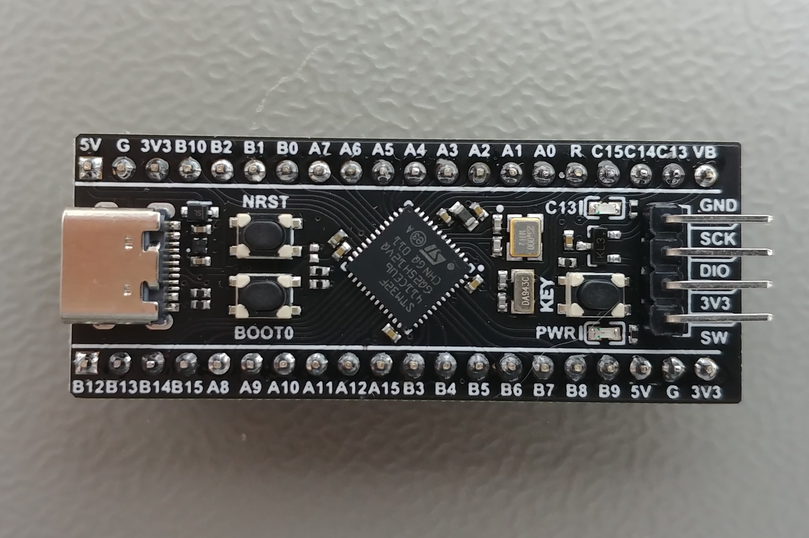
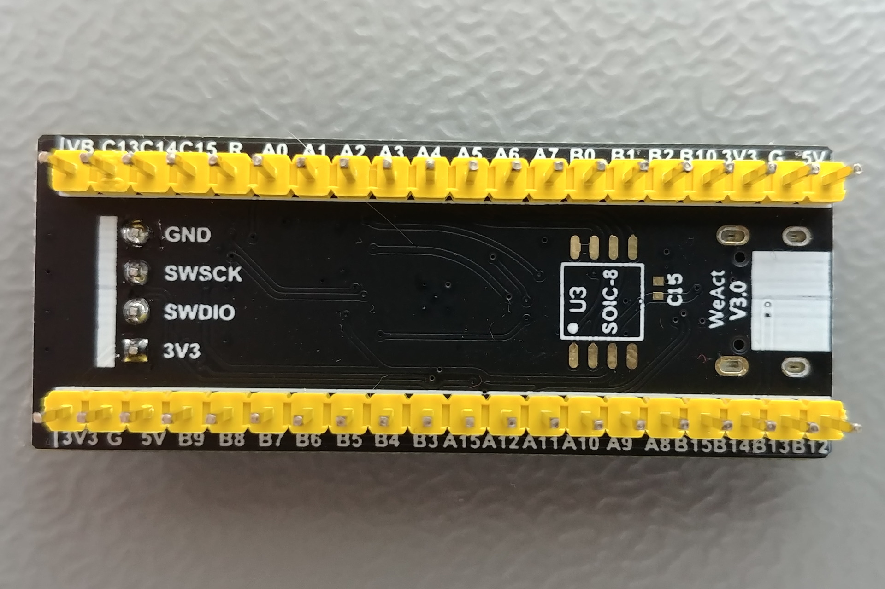

## Propuesta ##

La información sobre el diseño fue obtenida principalmente de [STM32-base](https://stm32-base.org/boards/STM32F401CEU6-WeAct-Black-Pill-V3.0).

### Esquemático

[Circuito esquemático](original-schematic-STM32F401CEU6_WeAct_Black_Pill_V3.0.pdf), obtenido [aquí](https://stm32-base.org/assets/pdf/boards/original-schematic-STM32F401CEU6_WeAct_Black_Pill_V3.0.pdf).

### Vista superior

### Vista inferior

